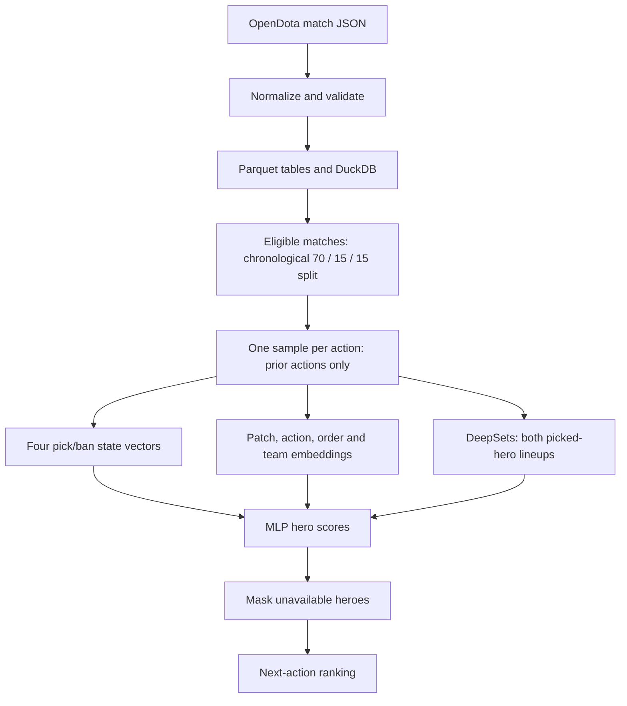

# Dota 2 Draft Prediction

A PyTorch project for predicting the next pick or ban in professional Dota 2 drafts. It covers API collection, data validation, Parquet/DuckDB storage, chronological dataset construction, statistical baselines, and neural model experiments.

The behavior model predicts what a team is likely to do. An experimental value model predicts factual match outcomes; it has not been validated as a strategy that improves win rate.

## Recorded Results

The current data snapshot contains **25,158 eligible matches** and **603,640 draft actions**. B+ (team embeddings + DeepSets + MLP, 60-day training recency decay) recorded **31.59% validation Top-5** for seed 42.

This is a model-selection result, not final test performance. An older statistical baseline used an earlier data snapshot and is not used here to claim a numerical improvement. See the [experiment report](reports/results.md), [machine-readable results](reports/results.json), and [model/data notes](docs/model-card.md) for configurations, limitations, and failed experiments.

## Architecture



Validation uses the actual preceding draft actions for each prediction. It does not roll out the model's own earlier predictions. Outcomes and inferred positions are labels for optional experiments, not inputs to the B+ behavior model.

## Quick Start Without Match Data

Use Python 3.12 (the package requires Python 3.11 or newer). Run commands from the repository root. Dependencies have version ranges; exact historical training environments are not locked.

```bash
python -m venv .venv
```

Activate with `.venv\Scripts\activate.bat` in Windows CMD, or `source .venv/bin/activate` on Linux/macOS. Then:

```bash
python -m pip install -e .
python -m pytest -q
```

Tests generate synthetic fixtures in temporary directories. No API key, downloaded matches, or trained weights are required. To exercise chronological splitting, sample generation, and a tiny one-epoch value-model training run:

```bash
python -m pytest -q tests/test_dataset_pipeline.py tests/test_draft_value.py
```

GitHub Actions is configured for Windows and Linux with Python 3.12. Check the Actions tab for remote results after the workflow is pushed.

## Rebuild the Dataset

Full reproduction requires local OpenDota match details; raw data and trained weights are not bundled. A live API download may return a different snapshot. Configure paths and request pacing in `config/settings.yaml`; `.env.example` lists the optional `OPENDOTA_API_KEY` variable.

Inspect collection options before downloading:

```bash
python -m src.collect_matches --help
```

With JSON match details under `data/raw/match_details`, run these steps in order. Normalization with `--force` rebuilds derived outputs. `data/processed/test` is a historical directory name for **all normalized data**, not just the held-out test split.

```bash
python -m src.normalize --input-dir data/raw/match_details --output-dir data/processed/test --database data/database/dota2.duckdb --force
python -m scripts.verify_normalization --database data/database/dota2.duckdb
python -m scripts.profile_dataset
python -m scripts.build_dataset_splits
python -m scripts.build_hero_role_priors
python -m scripts.build_draft_samples
python -m scripts.build_match_rosters
python -m scripts.verify_dataset_pipeline
```

`build_draft_samples` requires `player_positions.parquet`, produced by `build_hero_role_priors`. Hero role priors are aggregated from training matches only; per-match inferred positions serve as optional supervised labels.

The legacy statistical evaluation script evaluates both validation and test. Running it exposes test metrics; it should not be part of repeated hyperparameter tuning:

```bash
python -m scripts.evaluate_statistical_baselines
```

## Train Models

An example B+ run using the later experiments' physical batch and accumulation settings:

```bash
python -m scripts.train_draft_mlp --model b --output-dir data/processed/neural/b_plus_reproduction --epochs 40 --batch-size 512 --accumulation-steps 4 --patience 5 --scheduler-patience 2 --lineup-encoder --recency-half-life-days 60 --seed 42
```

This command does not guarantee the historical 31.59% result: the older seed-42 summary did not record physical batch size, and accumulation is not bitwise equivalent to one large batch. Checkpoints and summaries are saved in the chosen directory; rerunning there may overwrite them. Early stopping selects validation Top-5.

The independent value model trains on actual Picks and selects validation log loss:

```bash
python -m scripts.train_draft_value --output-dir data/processed/neural/value_reproduction --epochs 40 --batch-size 512 --accumulation-steps 4 --patience 5 --scheduler-patience 2 --recency-half-life-days 60 --seed 42
```

Use `python -m scripts.train_draft_mlp --help` for sequence, attention, role, and outcome experiments.

## Try the Model Locally

With a trusted local B+ checkpoint, start the interactive draft sandbox:

```bash
python -m scripts.serve_demo
```

Open `http://127.0.0.1:8765` for the project homepage: dataset counts and temporal splits, recency experiments, searchable validation results, repeat-seed comparisons, outcome-model metrics and evaluation limitations. Figures are read from `reports/results.json`; the report can be downloaded from the page. Regenerate it with `python -m scripts.export_portfolio_report` after updating recorded experiments. A missing or invalid report produces an explicit error rather than placeholder statistics.

Follow **Open draft sandbox**, or open `http://127.0.0.1:8765/sandbox` directly. Search teams by name or ID, choose the next acting side and Pick/Ban, then select a hero from the pool or prediction list. The sandbox supports search, undo/redo, history rewind, and JSON import/export. Team labels come from local historical match data; model inputs remain numeric IDs. The example is synthetic, not a recorded match. This is a freeform sandbox, not a patch-specific Captain's Mode rules engine.

The default checkpoint is `data/processed/neural/decay_current_60/model_b_best.pt`. Specify `--checkpoint PATH` for another compatible MLP checkpoint, `--report PATH` for the public aggregate report (needed outside a repository checkout), or `--port 8766` if the port is occupied. Checkpoints using player rosters and full Model D Transformer checkpoints are not supported. Weights are not bundled with the repository; the app fails clearly when the checkpoint is absent, rather than substituting random predictions.

The same predictor is available without a browser:

```bash
python -m scripts.predict_draft --input examples/draft_state.json
```

It requires only the checkpoint and the input state, not the raw data, Parquet tables, or DuckDB. Returned probabilities are uncalibrated next-action softmax scores, **not win probabilities**. Unknown patches and teams use the saved model's unknown embeddings with explicit warnings.

See [the inference contract and deployment boundaries](docs/inference.md). The server binds only to loopback; it is a local research preview, not a public production API. Browser portraits require access to Valve's CDN. No game data or weights are uploaded by the demo.

## Project Layout

| Path | Purpose |
| --- | --- |
| `src/` | Collection, normalization, datasets and models |
| `scripts/` | Dataset construction, training and evaluation |
| `tests/` | Synthetic data, model and pipeline tests |
| `reports/` | Public aggregate results, without raw matches or checkpoints |
| `docs/model-card.md` | Data, interpretation and limitations |
| `docs/portfolio.md` | Copy suitable for a personal website |
| `src/web/` | Local BP sandbox and attributed display assets |
| `examples/draft_state.json` | Synthetic input for CLI inference |
| `data/` | Local raw/generated artifacts, excluded from Git |

Regenerate the public report from the existing local experiment summaries:

```bash
python -m scripts.export_portfolio_report
```

The exporter expects the listed historical runs and fails on missing files or incompatible sample counts. It does not train models. The older `compare_neural_models.py` covers legacy experiments and should not be used as the current portfolio results table.

## Data and Release Status

Data originates from OpenDota. Data, game assets, and external reference repositories are not covered by this project's code terms. No code license has been selected yet; public source availability alone does not grant a reuse license.

Before a model release: rerun baselines on the same frozen split, record dataset hashes and exact dependencies, freeze model selection, and report a final held-out neural evaluation. Historical statistical test metrics have already been inspected and must be disclosed. Public hosting and checkpoint distribution remain follow-up work; the inference CLI and interactive demo currently run locally.
